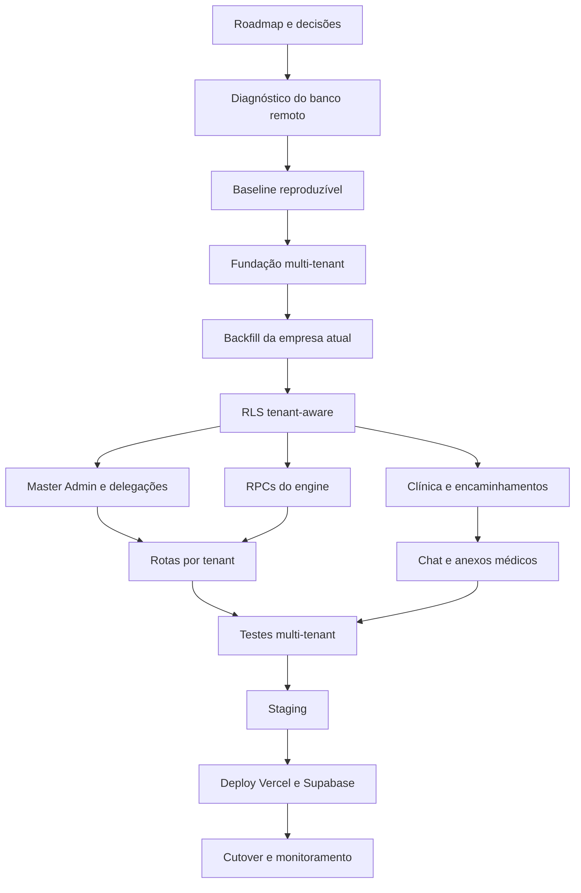

# Plano de implementação — engine seguro e multi-tenant

> **Este arquivo é a fonte oficial de acompanhamento do projeto.**
>
> Deve ser atualizado sempre que uma tarefa for iniciada, concluída, bloqueada,
> replanejada ou validada. Nenhuma etapa estrutural deve começar sem constar aqui.

## Objetivo final

Transformar a aplicação atual, criada para uma única empresa e com regras de
negócio concentradas no frontend, em uma plataforma de recrutamento:

- multi-tenant, com isolamento integral entre empresas;
- acessada por URL canônica no formato `/t/:empresa`, por exemplo
  `https://processflow-hub.vercel.app/t/empresa-x`;
- administrada por um `Platform Master Admin`;
- com identidade visual individual por empresa, configurada pelo Master Admin;
- com administradores titulares e substitutos por empresa;
- com engine de negócio executado por RPCs SQL transacionais;
- com integrações secretas executadas apenas em Supabase Edge Functions;
- com portal restrito para a clínica de saúde ocupacional;
- com chat e anexos privados entre o RH local e a clínica;
- sem `service_role`, Gemini, SMTP ou outros segredos no bundle do navegador;
- documentada, testada e implantável no Supabase e na Vercel.

## Definição de pronto

O projeto só será considerado concluído quando:

1. todas as tabelas de negócio tiverem `tenant_id` ou vínculo equivalente;
2. RLS impedir acesso cruzado mesmo com chamadas manuais à API;
3. nenhuma regra crítica depender exclusivamente do frontend;
4. nenhuma chave secreta estiver no bundle ou em tabela legível pelo cliente;
5. o Master Admin conseguir provisionar uma empresa e seu administrador;
6. o Master Admin conseguir publicar cores e logos próprios para cada empresa;
7. a identidade visual de um tenant nunca aparecer no site de outro tenant;
8. substituições administrativas respeitarem período, motivo e revogação;
9. cada slug exibir somente vagas e conteúdo da empresa correspondente;
10. a clínica enxergar somente encaminhamentos explicitamente liberados;
11. clínica e RH conseguirem trocar mensagens e anexos no encaminhamento;
12. testes automatizados comprovarem isolamento entre pelo menos dois tenants;
13. migrations puderem reconstruir o banco sem ajustes manuais ocultos;
14. documentação de arquitetura, migrations, operação, testes e deploy estiver
    atualizada;
15. build, typecheck, testes e smoke tests de produção passarem.

---

## Legenda de status

| Símbolo | Status | Significado |
|---|---|---|
| ✅ | Concluída | Implementada e validada conforme o critério de aceite |
| 🔄 | Em andamento | Trabalho iniciado, ainda não concluído ou validado |
| 🟡 | Pronta para executar | Dependências atendidas; pode ser a próxima tarefa |
| ⏳ | Pendente | Ainda não iniciada |
| ⛔ | Bloqueada | Depende de informação, acesso ou decisão externa |
| ⚠️ | Em revisão | Implementada, mas aguarda revisão ou validação |

## Regra de atualização

Ao trabalhar em qualquer item:

1. mudar o status para `🔄 Em andamento`;
2. registrar a data e os arquivos envolvidos em **Registro de andamento**;
3. executar validação específica;
4. somente marcar `✅ Concluída` se a validação realmente passar;
5. se depender de informação externa, marcar `⛔ Bloqueada` e registrar exatamente
   o que falta;
6. não iniciar uma migration dependente do schema remoto enquanto a descoberta do
   banco não estiver concluída.

---

## Resumo executivo atual

**Atualizado em:** 2026-09-26

| Fase | Situação | Progresso estimado |
|---|---|---:|
| 0. Governança e planejamento | 🔄 Em andamento | 80% |
| 1. Descoberta e baseline do banco | 🔄 Em andamento | 55% |
| 2. Contenção imediata de segurança | 🔄 Em andamento | 45% |
| 3. Arquitetura multi-tenant | 🔄 Em andamento | 25% |
| 4. Fundação SQL multi-tenant | ✅ Concluída | 100% |
| 5. Migração dos dados atuais | 🔄 Em andamento | 40% |
| 6. RLS e isolamento por tenant | ✅ Concluída | 90% |
| 7. Provisionamento pelo Master Admin | ✅ Concluída | 85% |
| 8. Administrador titular e substituto | ⏳ Pendente | 0% |
| 9. URLs e contexto de tenant | 🔄 Em andamento | 35% |
| 10. Engine de recrutamento em RPC/SQL | ⏳ Pendente | 0% |
| 11. Clínica ocupacional | ✅ Concluída | 80% |
| 12. Chat e anexos do exame médico | 🔄 Em andamento | 60% |
| 13. Edge Functions e integrações | 🔄 Em andamento | 60% |
| 14. Refatoração do frontend | 🔄 Em andamento | 20% |
| 15. Testes e CI | 🔄 Em andamento | 30% |
| 16. Documentação final | 🔄 Em andamento | 10% |
| 17. Deploy Supabase/Vercel | ⏳ Pendente | 0% |
| 18. Cutover e operação | ⏳ Pendente | 0% |

> O percentual representa avanço técnico aproximado, não prazo decorrido.

---

# Backlog detalhado

## Fase 0 — Governança e planejamento

| ID | Status | Ação | Critério de aceite |
|---|---|---|---|
| GOV-001 | ✅ | Criar roadmap oficial do projeto | Este arquivo existe e contém fases, dependências e status |
| GOV-002 | 🔄 | Manter o roadmap atualizado a cada alteração | Toda mudança futura atualiza este documento |
| GOV-003 | 🔄 | Criar registro de decisões arquiteturais (`docs/adr/`) | Decisões de tenancy, identidade, URL e clínica documentadas |
| GOV-004 | ⏳ | Definir estratégia de ambientes | Local, preview, staging e produção descritos |
| GOV-005 | ⏳ | Definir política de rollback de migrations | Cada fase de migration possui backup, verificação e reversão |

## Fase 1 — Descoberta e baseline do banco real

| ID | Status | Ação | Critério de aceite |
|---|---|---|---|
| DB-001 | ✅ | Criar diagnóstico de schema | `supabase/diagnostics/01_schema_inventory.sql` criado |
| DB-002 | ✅ | Criar diagnóstico de segurança e Storage | `02_security_and_storage.sql` criado |
| DB-003 | ✅ | Criar diagnóstico de funções/RPCs | `03_function_definitions.sql` criado |
| DB-004 | ✅ | Criar verificações operacionais | `04_operational_checks.sql` criado |
| DB-005 | ✅ | Executar os quatro diagnósticos no banco remoto | Resultados exportados e disponibilizados sem segredos |
| DB-006 | ✅ | Consolidar schema real usado pelo recrutamento | Todas as tabelas, colunas, FKs, RPCs, policies e buckets conhecidos |
| DB-007 | 🔄 | Criar migration baseline do schema remoto ausente | Banco novo reproduz integralmente o runtime atual |
| DB-008 | ⏳ | Detectar e eliminar drift entre remoto e repositório | Diff declarativo sem objetos desconhecidos |

**Situação atual:** a descoberta do banco remoto (`DB-005`/`DB-006`) foi registrada como concluída em 2026-08-08. O bloqueio estrutural agora é transformar essa descoberta em uma baseline reproduzível (`DB-007`) e confirmar qual projeto Supabase de staging/produção está vinculado ao runtime antes de aplicar migrations.

## Fase 2 — Contenção imediata de segurança

| ID | Status | Ação | Critério de aceite |
|---|---|---|---|
| SEC-001 | ⚠️ | Remover `service_role` do namespace `VITE_*` | Nenhum módulo do frontend referencia a chave; bundle inspecionado |
| SEC-002 | ⚠️ | Remover Gemini do navegador | Frontend envia somente IDs para Edge Function; bundle sem chave/SDK |
| SEC-003 | 🔄 | Substituir verificação vulnerável por fluxo server-side | Código nunca retorna ao cliente; fluxo de duas fases validado |
| SEC-004 | 🔄 | Migrar operações administrativas para Edge Function | Criar/editar/resetar/inativar RH somente no servidor |
| SEC-005 | ⏳ | Retirar SMTP de `settings` e do navegador | Senha removida da tabela/payload e rotacionada |
| SEC-006 | ✅ | Substituir relay público de e-mail | Somente eventos/templates de negócio autenticados são aceitos |
| SEC-007 | ✅ | Proteger retry/cron de e-mail | Claim atômico, idempotência e segredo interno |
| SEC-008 | ⏳ | Tornar buckets sensíveis privados | Currículos, provas e anexos usam URL assinada |
| SEC-009 | ⏳ | Remover scripts com credenciais fixas | Nenhuma senha literal operacional no repositório/histórico ativo |
| SEC-010 | ⏳ | Rotacionar segredos potencialmente expostos | Service role, Gemini, SMTP, n8n e contas seed rotacionados |
| SEC-011 | 🔄 | Corrigir sessão baseada em `localStorage` | Autenticação deriva de sessão Supabase válida e perfil reconsultado |
| SEC-012 | ✅ | Adicionar headers de segurança e CSP | Produção restringe scripts, frames e conexões externas |

## Fase 3 — Arquitetura multi-tenant

### Decisões já adotadas

| ID | Status | Decisão |
|---|---|---|
| ARC-001 | ✅ | Usar rota canônica `/t/:tenantSlug`, não `\empresa` |
| ARC-002 | ✅ | Manter uma única aplicação Vercel e um único projeto Supabase inicialmente |
| ARC-003 | ✅ | Isolamento principal no PostgreSQL com `tenant_id` + RLS |
| ARC-004 | ✅ | Clínica ocupacional recebe acesso por encaminhamento, não por membership global no tenant contratante |
| ARC-005 | ✅ | Chat da clínica pertence ao encaminhamento médico, não ao chat geral da candidatura |
| ARC-011 | ✅ | Branding é armazenado por tenant e publicado exclusivamente pelo Platform Master Admin |
| ARC-012 | ✅ | Tema usa tokens predefinidos; não será permitido CSS arbitrário informado pelo usuário |

### Decisões ainda necessárias

| ID | Status | Ação | Critério de aceite |
|---|---|---|---|
| ARC-006 | 🟡 | Definir se candidato terá currículo global ou cópia por tenant | ADR aprovado com regras LGPD e revogação |
| ARC-007 | 🟡 | Definir se haverá uma ou várias clínicas ocupacionais | Modelo suporta contrato atual e expansão futura |
| ARC-008 | 🟡 | Definir domínio customizado por empresa em fase futura | Estratégia de host/subdomínio documentada |
| ARC-009 | ⏳ | Definir retenção e base legal de currículo/IA/exame | Política de dados aprovada e implementável |
| ARC-010 | ⏳ | Definir papéis finais e matriz de permissões | Matriz cobrindo Master, Admin, substituto, RH, candidato e clínica |

### URL recomendada

```text
https://processflow-hub.vercel.app/                 -> portal/plataforma
https://processflow-hub.vercel.app/master           -> Master Admin
https://processflow-hub.vercel.app/t/empresa-x      -> site público da empresa
https://processflow-hub.vercel.app/t/empresa-x/login
https://processflow-hub.vercel.app/t/empresa-x/admin
https://processflow-hub.vercel.app/t/empresa-x/rh
https://processflow-hub.vercel.app/t/empresa-x/candidato
https://processflow-hub.vercel.app/saude-ocupacional -> portal da clínica
```

O caractere `\` não deve ser usado em URL web. O padrão correto é `/`.

## Fase 4 — Fundação SQL multi-tenant

| ID | Status | Ação | Critério de aceite |
|---|---|---|---|
| TEN-001 | ✅ | Criar tabela `tenants` | UUID, CNPJ normalizado/único, nome, slug único, status e branding |
| TEN-002 | ✅ | Criar papéis de plataforma | `platform_master_admin` separado dos papéis de tenant |
| TEN-003 | ✅ | Criar `tenant_memberships` | Usuário pode ter papel e status por empresa |
| TEN-004 | ✅ | Criar funções `current_tenant_id`/`has_tenant_role` | Helpers seguros, com `search_path` e ACL restrita |
| TEN-005 | ✅ | Criar contexto de tenant por slug | RPC pública retorna somente dados públicos do tenant ativo |
| TEN-006 | ✅ | Adicionar `tenant_id` às tabelas legadas | Bridge `20260808100000` aplicada; colunas nullable |
| TEN-007 | 🔄 | Criar FKs e índices compostos por tenant | FKs NOT VALID criadas; validação pendente do backfill |
| TEN-008 | ⏳ | Tornar unicidades tenant-aware | Ex.: código da vaga e login conforme regra definida |
| TEN-009 | ⏳ | Tornar `tenant_id` obrigatório | Apenas após backfill e validação integral |
| TEN-010 | ✅ | Criar auditoria com `tenant_id` | Toda ação privilegiada identifica plataforma/tenant/ator |
| TEN-011 | ✅ | Criar `tenant_branding` | Um tema ativo por tenant, com tokens de cor e paths de assets |
| TEN-012 | ✅ | Criar histórico de versões do branding | Publicação, autor, versão anterior e rollback auditáveis |
| TEN-013 | ✅ | Criar projeção pública segura do branding | Visitante lê somente tema publicado do slug ativo |

## Fase 5 — Migração dos dados da empresa atual

| ID | Status | Ação | Critério de aceite |
|---|---|---|---|
| MIG-001 | 🔄 | Criar tenant da empresa atual | Template criado em `20260811110000_legacy_data_backfill.sql`; placeholder `<COMPANY_SLUG>` |
| MIG-002 | 🔄 | Fazer backfill de memberships | Incluído no template de backfill |
| MIG-003 | 🔄 | Fazer backfill das tabelas de negócio | Template cobre vagas → candidaturas → mensagens → etc. (ordem FK) |
| MIG-004 | ⏳ | Fazer backfill de Storage | Paths reorganizados por tenant sem quebrar downloads |
| MIG-005 | ⏳ | Validar contagens antes/depois | Contagens e checksums documentados |
| MIG-006 | ⏳ | Criar backup e ensaio de rollback | Restauração testada em staging |

## Fase 6 — RLS e isolamento

| ID | Status | Ação | Critério de aceite |
|---|---|---|---|
| RLS-001 | ✅ | Criar matriz de acesso por tabela/operação | SELECT/INSERT/UPDATE/DELETE explicitados em `20260811120000_rls_legacy_tenant_aware.sql` |
| RLS-002 | ✅ | Aplicar RLS a todas as tabelas tenant-aware | Policies em vagas, candidaturas, mensagens, users, provas, settings, etc. |
| RLS-003 | ✅ | Remover policies `USING (true)` sensíveis | Substituídas por policies restritivas com `current_tenant_id()` |
| RLS-004 | ✅ | Criar views públicas de vagas | `public_vagas_view` criada sem PII |
| RLS-005 | 🔄 | Bloquear mutações diretas do engine | Policies INSERT/UPDATE restringem; RPCs pendentes de refatoração completa |
| RLS-006 | ⏳ | Restringir auditoria/eventos a escrita server-side | Ator e timestamp não são forjáveis |
| RLS-007 | 🔄 | Testar isolamento com usuário malicioso | Scripts SQL criados em `tests/rls/` |
| RLS-008 | ⏳ | Executar Supabase database linter | Sem alertas críticos de segurança |

## Fase 7 — Master Admin e provisionamento

| ID | Status | Ação | Critério de aceite |
|---|---|---|---|
| MST-001 | ✅ | Criar portal `/master` | `src/pages/Master.tsx` com Dashboard, TenantList, BrandingEditor |
| MST-002 | ✅ | Criar empresa por CNPJ/nome/slug | `TenantProvisionForm` → Edge Function `tenant-provisioning` |
| MST-003 | ✅ | Criar administrador titular | Edge Function cria Auth user + membership + provision_tenant RPC |
| MST-004 | ✅ | Configurar branding e URL | `MasterBrandingEditor` com tokens de cor e preview |
| MST-005 | ✅ | Criar editor de identidade visual | 13 tokens de cor editáveis com grid color picker |
| MST-006 | 🔄 | Gerenciar logos da empresa | Paths reservados; upload via Storage pendente |
| MST-007 | 🔄 | Validar cores e acessibilidade | Validação hex no Edge Function; contraste WCAG pendente |
| MST-008 | ✅ | Publicar/reverter versão do tema | `_publish_tenant_branding` RPC; versionamento no `MasterBrandingEditor` |
| MST-009 | ✅ | Suspender/reativar tenant | `_suspend_tenant`/`_activate_tenant` RPCs via Edge Function |
| MST-010 | ✅ | Listar saúde operacional por tenant | `MasterDashboard` com stats e tabela de tenants |
| MST-011 | 🔄 | Criar fluxo de convite seguro | Admin provisionado com senha temporária; convite por e-mail pendente |

## Fase 8 — Administrador titular e substituto

| ID | Status | Ação | Critério de aceite |
|---|---|---|---|
| ADM-001 | ⏳ | Modelar delegações administrativas | Titular, substituto, motivo, início, fim e status |
| ADM-002 | ⏳ | Validar período e sobreposição | Banco impede duas delegações conflitantes |
| ADM-003 | ⏳ | Ativar substituição automaticamente | Acesso vale somente dentro do período aprovado |
| ADM-004 | ⏳ | Revogar em retorno/desligamento | Sessões e permissões deixam de valer |
| ADM-005 | ⏳ | Exigir justificativa e auditoria | Toda delegação tem autor e histórico imutável |
| ADM-006 | ⏳ | Definir poderes do substituto | Matriz explícita; sem promoção silenciosa permanente |
| ADM-007 | ⏳ | Notificar titular/substituto/Master | Eventos e e-mails idempotentes |

## Fase 9 — URLs e contexto de tenant no frontend

| ID | Status | Ação | Critério de aceite |
|---|---|---|---|
| URL-001 | 🔄 | Criar `TenantProvider` | Resolve slug e mantém contexto imutável da navegação |
| URL-002 | 🔄 | Prefixar rotas públicas e privadas com `/t/:slug` | Links e redirects preservam tenant |
| URL-003 | 🔄 | Validar membership após login | Usuário sem vínculo não entra no tenant |
| URL-004 | 🔄 | Aplicar branding por empresa | Nome, logos e tokens vêm da projeção pública do slug ativo |
| URL-005 | 🔄 | Aplicar tema aos menus | Sidebar, navegação, estados ativo/hover e textos usam tokens validados |
| URL-006 | 🔄 | Aplicar tema à página inicial | Hero, fundos, botões, destaques e cards usam tokens validados |
| URL-007 | 🔄 | Implementar fallback visual | Tenant sem tema completo recebe tema padrão seguro |
| URL-008 | 🔄 | Atualizar branding sem cache incorreto | Versão publicada invalida cache somente do tenant alterado |
| URL-009 | 🔄 | Tratar slug inexistente/suspenso | Página 404/indisponível sem vazamento |
| URL-010 | 🔄 | Evitar tenant apenas em estado local | Toda consulta deriva tenant autorizado no banco |
| URL-011 | ⏳ | Preparar suporte futuro a domínio próprio | Resolver host para tenant sem alterar RLS |

## Fase 10 — Engine de recrutamento em RPC/SQL

| ID | Status | Ação | Critério de aceite |
|---|---|---|---|
| ENG-001 | ⏳ | Normalizar status de vagas e candidaturas | Um modelo canônico documentado |
| ENG-002 | ⏳ | RPC `create_job` | Código, owner, tenant e auditoria transacionais |
| ENG-003 | ⏳ | RPC `update_job` | Lock, owner e regras de edição no banco |
| ENG-004 | ⏳ | RPC `transition_job` | Máquina de estado usa horário/configuração do banco |
| ENG-005 | ⏳ | RPC `transfer_job_owner` | Vaga e histórico atualizados atomicamente |
| ENG-006 | ⏳ | Job de retorno automático de owner | Não depende de abrir uma tela |
| ENG-007 | ⏳ | RPC `apply_to_job` | Tenant, vaga aberta, currículo e unicidade validados |
| ENG-008 | ⏳ | RPC `transition_application` | Fase/status/evento/auditoria na mesma transação |
| ENG-009 | ⏳ | RPC de triagem em lote | Resultado por item e autorização tenant-aware |
| ENG-010 | ⏳ | RPC de mensagens | Participantes, anexos, unread e evento atômicos |
| ENG-011 | ⏳ | RPCs de provas/versionamento | Modelo único de versão e vínculo à vaga |
| ENG-012 | ⏳ | RPC de resultado de prova | Nota, aprovação e transição consistentes |
| ENG-013 | ⏳ | RPC de configurações | Reconciliar listas e regras em uma transação |
| ENG-014 | ⏳ | Triggers de auditoria/outbox | Nenhum log crítico gravado pelo navegador |
| ENG-015 | ⏳ | Views/RPCs de dashboards | Métricas calculadas no banco e filtradas por tenant |
| ENG-016 | ⏳ | Views/RPCs de relatórios | Sem cálculo oficial no navegador |
| ENG-017 | ⏳ | Remover mutações diretas legadas | Busca estática não encontra writes críticos no frontend |

## Fase 11 — Clínica de saúde ocupacional

| ID | Status | Ação | Critério de aceite |
|---|---|---|---|
| MED-001 | 🔄 | Criar tenant/organização da clínica | Clínica possui identidade própria e usuários próprios |
| MED-002 | 🔄 | Criar contratos tenant-clínica | Empresa só encaminha para clínica contratada/ativa |
| MED-003 | 🔄 | Criar `medical_referrals` | Snapshot mínimo da vaga e candidato encaminhado |
| MED-004 | 🔄 | RPC `refer_to_medical_exam` | Somente RH autorizado e fase anterior válida |
| MED-005 | 🔄 | Restringir dados liberados | Clínica não lê currículo completo nem outras vagas |
| MED-006 | 🔄 | Criar portal `/saude-ocupacional` | Usuário da clínica vê somente seus encaminhamentos |
| MED-007 | 🔄 | Registrar agendamento/status/resultado | Máquina de estado e auditoria no servidor |
| MED-008 | 🔄 | Definir resultado mínimo compartilhado | Ex.: apto/inapto/pendente; dados clínicos sensíveis separados |
| MED-009 | 🔄 | Implementar revogação/encerramento | Acesso termina conforme regra sem apagar auditoria |
| MED-010 | 🔄 | Validar LGPD e sigilo médico | Minimização, retenção e acessos documentados |

### Regra fundamental da clínica

A clínica **não será membro comum do tenant contratante**. O acesso será concedido
por linha de `medical_referrals`, contendo apenas os dados mínimos necessários.
As policies deverão exigir simultaneamente:

- usuário ativo da clínica;
- clínica vinculada ao encaminhamento;
- encaminhamento ativo;
- acesso ao recurso específico solicitado.

## Fase 12 — Chat e anexos do exame médico

| ID | Status | Ação | Critério de aceite |
|---|---|---|---|
| CHAT-001 | 🔄 | Criar conversa por encaminhamento | Uma thread canônica por referral |
| CHAT-002 | 🔄 | RPC de envio de mensagem | Autor derivado de `auth.uid()` e participante validado |
| CHAT-003 | 🔄 | Implementar comunicação recíproca | RH local e clínica enviam/recebem mensagens |
| CHAT-004 | 🔄 | Criar bucket privado de anexos médicos | Sem URL pública permanente |
| CHAT-005 | ✅ | Autorizar upload por referral | Edge Function `storage-authorize` com `sign_upload` |
| CHAT-006 | ✅ | Validar tamanho/MIME/conteúdo | MIME (pdf, png, jpeg) e max 10MB validados no Edge Function |
| CHAT-007 | ✅ | Criar URLs assinadas de curta duração | `sign_download` com expiry de 1h; `medical-attachments.ts` lib |
| CHAT-008 | ⏳ | Implementar read receipts | Leitura e contadores no servidor |
| CHAT-009 | ⏳ | Aplicar retenção e limpeza de órfãos | Política operacional documentada e testada |

## Fase 13 — Edge Functions e integrações

| ID | Status | Ação | Critério de aceite |
|---|---|---|---|
| EDGE-001 | ⚠️ | `candidate-analysis` | JWT, tenant/owner, lease, minimização e persistência validados |
| EDGE-002 | ⚠️ | `email-verification` | CAPTCHA, hash, duas fases e retry validados |
| EDGE-003 | ⚠️ | `admin-users` | Admin ativo, tenant correto, Auth e auditoria validados |
| EDGE-004 | ✅ | `tenant-provisioning` | `supabase/functions/tenant-provisioning/index.ts` — provision, suspend, activate, list |
| EDGE-005 | ⏳ | `mail-dispatch` | Templates server-side, outbox e Resend idempotente |
| EDGE-006 | ✅ | `storage-authorize` | `supabase/functions/storage-authorize/index.ts` — sign_upload/sign_download para anexos médicos |
| EDGE-007 | ⏳ | `medical-referral` se necessário | Efeitos externos separados das RPCs SQL |
| EDGE-008 | ⏳ | Scheduler de retries/retornos/SLA | Claims com `SKIP LOCKED` e leases |
| EDGE-009 | ⏳ | Configurar secrets por ambiente | Nenhum segredo em Vite/Vercel frontend |
| EDGE-010 | ⏳ | Criar observabilidade e alertas | Request ID interno, erro sanitizado e métricas |

## Fase 14 — Refatoração do frontend

| ID | Status | Ação | Critério de aceite |
|---|---|---|---|
| FE-001 | 🔄 | Substituir Gemini por Edge Function | Call sites não importam SDK/chave |
| FE-002 | 🔄 | Substituir Admin APIs por Edge Function | Tela usa `admin-users` |
| FE-003 | 🔄 | Substituir verificação RPC/n8n por Edge Function | Challenge opaco em sessão |
| FE-004 | ⏳ | Remover SMTP de todas as telas | Nenhum `smtpPass` no estado/rede |
| FE-005 | ⏳ | Substituir writes por RPCs do engine | Frontend apenas solicita ações de negócio |
| FE-006 | ⏳ | Dividir arquivos monolíticos | Componentes/hooks por domínio testáveis |
| FE-007 | ⏳ | Gerar tipos Supabase | Queries/RPCs tipadas pelo schema |
| FE-008 | ⏳ | Corrigir acessibilidade e estados de erro | Fluxos críticos navegáveis e mensagens acionáveis |
| FE-009 | ⏳ | Remover código morto e scripts legados | Build sem referências obsoletas |

## Fase 15 — Testes e CI

| ID | Status | Ação | Critério de aceite |
|---|---|---|---|
| TST-001 | ⏳ | Configurar testes unitários | Regras puras e helpers cobertos |
| TST-002 | 🔄 | Configurar testes de banco/RLS | Scripts SQL criados em `tests/rls/isolation.test.sql` e `tests/rls/clinic_access.test.sql` |
| TST-003 | ✅ | Criar fixture Tenant A/Tenant B | `tests/fixtures/multi_tenant_seed.sql` com 3 tenants, 7 users, dados de negócio |
| TST-004 | ⏳ | Testar isolamento público | Slug A nunca retorna vagas de B |
| TST-005 | 🔄 | Testar isolamento autenticado | 8 testes SQL em `tests/rls/isolation.test.sql` |
| TST-006 | 🔄 | Testar clínica | 5 testes SQL em `tests/rls/clinic_access.test.sql` |
| TST-007 | ⏳ | Testar chat/anexos médicos | Participantes autorizados e terceiros negados |
| TST-008 | ⏳ | Testar delegação administrativa | Antes/durante/depois do período |
| TST-009 | ⏳ | Testar concorrência/idempotência | Candidatura, IA, e-mail e transições sem duplicata |
| TST-010 | ⏳ | Configurar E2E | Master cria tenant até fluxo de exame médico |
| TST-011 | ✅ | Criar CI | `.github/workflows/ci.yml` — typecheck, build, Deno check, migration validation |
| TST-012 | ⏳ | Executar teste de segurança manual | Chamadas REST forjadas não quebram isolamento |
| TST-013 | ⏳ | Testar isolamento do branding | Tema/logo A nunca aparece em rotas, cache ou API do Tenant B |
| TST-014 | ⏳ | Testar permissões do editor visual | Tenant Admin e RH não publicam tema reservado ao Master |
| TST-015 | ⏳ | Testar acessibilidade do tema | Contraste, foco e legibilidade passam nos tokens publicados |
| TST-016 | ⏳ | Testar rollback de identidade visual | Versão anterior é restaurada atomicamente |

## Fase 16 — Documentação

| ID | Status | Ação | Critério de aceite |
|---|---|---|---|
| DOC-001 | ✅ | Documentar descoberta do banco | `docs/DATABASE_DISCOVERY.md` |
| DOC-002 | ✅ | Criar plano de implementação | Este arquivo |
| DOC-003 | ⏳ | Reescrever README | Instalação, arquitetura, ambientes e comandos reais |
| DOC-004 | ⏳ | Documentar arquitetura multi-tenant | Diagramas, fronteiras e decisões |
| DOC-005 | ⏳ | Criar catálogo de migrations | Ordem, dependências, impacto e rollback |
| DOC-006 | ⏳ | Documentar RPCs | Contratos, autorização e exemplos |
| DOC-007 | ⏳ | Documentar Edge Functions | Secrets, deploy, payloads e erros |
| DOC-008 | ⏳ | Criar guia de teste multi-tenant | Passo a passo manual e automatizado |
| DOC-009 | ⏳ | Criar guia de deploy Vercel/Supabase | Staging, produção e rollback |
| DOC-010 | ⏳ | Criar runbook operacional | Incidentes, retries, rotação e suporte |
| DOC-011 | ⏳ | Documentar LGPD/retenção | Currículos, IA, e-mails, chats e exame médico |
| DOC-012 | ⏳ | Documentar identidade visual por tenant | Tokens, assets, publicação, cache, acessibilidade e rollback |

## Fase 17 — Deploy Supabase e Vercel

| ID | Status | Ação | Critério de aceite |
|---|---|---|---|
| DEP-001 | ⏳ | Criar projetos Supabase staging/produção | Ambientes separados e vinculados |
| DEP-002 | ⏳ | Aplicar migrations em staging | Replay integral sem intervenção manual |
| DEP-003 | ⏳ | Configurar secrets das Edge Functions | Secrets server-side por ambiente |
| DEP-004 | ⏳ | Publicar Edge Functions | Versões e JWT settings corretos |
| DEP-005 | ⏳ | Configurar Vercel Preview/Production | Variáveis públicas apenas |
| DEP-006 | ⏳ | Configurar SPA rewrite | Deep links `/t/:slug/...` funcionam |
| DEP-007 | ⏳ | Configurar domínios e URLs de Auth | Redirects permitidos e tenant preservado |
| DEP-008 | ⏳ | Executar smoke test em preview | Tenant A, B, Master e clínica validados |
| DEP-009 | ⏳ | Promover para produção | Checklist e aprovação registrados |
| DEP-010 | ⏳ | Validar bundle de produção | Sem service role, Gemini, SMTP ou URLs secretas |

## Fase 18 — Cutover e operação

| ID | Status | Ação | Critério de aceite |
|---|---|---|---|
| OPS-001 | ⏳ | Congelar writes durante migração final | Janela comunicada e controlada |
| OPS-002 | ⏳ | Executar backup final | Restore point verificado |
| OPS-003 | ⏳ | Aplicar backfill/RLS final | Checks de integridade aprovados |
| OPS-004 | ⏳ | Rotacionar todos os segredos | Antigos revogados |
| OPS-005 | ⏳ | Monitorar erros e isolamento | Alertas e dashboards ativos |
| OPS-006 | ⏳ | Encerrar APIs e scripts legados | Superfície antiga inacessível |
| OPS-007 | ⏳ | Revisão pós-implantação | Pendências e melhorias registradas |

---

# Ordem obrigatória de execução



## Especificação inicial da identidade visual

O editor do `Platform Master Admin` deverá trabalhar com campos controlados, e
não com CSS livre. A proposta inicial de `tenant_branding` inclui:

| Grupo | Tokens/atributos iniciais |
|---|---|
| Identidade | `display_name`, `logo_primary_path`, `logo_light_path`, `favicon_path` |
| Menu lateral | `sidebar_background`, `sidebar_text`, `sidebar_active`, `sidebar_hover` |
| Página inicial | `home_background`, `hero_background`, `hero_text`, `primary_action`, `accent` |
| Componentes | `primary_color`, `secondary_color`, `link_color`, `focus_ring_color` |
| Controle | `version`, `status`, `published_at`, `published_by`, `updated_at` |

Regras obrigatórias:

1. cores devem ser normalizadas e validadas pelo servidor, inicialmente no
   formato hexadecimal `#RRGGBB`;
2. combinações críticas devem atender contraste WCAG AA;
3. o cliente recebe somente a versão `published` do tenant resolvido pelo slug;
4. upload de logo é autorizado somente para o Master Admin;
5. assets usam paths como `tenant-branding/{tenant_id}/{version}/...`;
6. inicialmente serão aceitos PNG e WebP; SVG só poderá ser habilitado com
   sanitização server-side específica;
7. tamanho, dimensões e MIME devem ser validados no servidor/Storage;
8. substituir uma logo não sobrescreve silenciosamente a anterior: cria uma
   nova versão e permite rollback;
9. toda publicação registra tenant, ator, versão anterior, horário e motivo;
10. não será permitido salvar URLs externas arbitrárias como logo;
11. o frontend deve aplicar tokens por variáveis CSS geradas internamente, sem
    inserir HTML ou CSS fornecido pelo administrador;
12. falha ao carregar tema/logo usa o branding padrão, nunca o tema de outro
    tenant.

## Próximas ações desbloqueáveis

1. **DB-007:** consolidar a baseline reproduzível do schema remoto a partir dos diagnósticos já registrados;
2. **ARC-006:** confirmar se o currículo será global ou isolado por empresa;
3. **SEC-005/SEC-006:** retirar o relay SMTP legado e exigir fluxo de e-mail server-side autenticado;
4. **SEC-012:** concluir CSP depois de inventariar as origens externas realmente necessárias;
5. **revisar e validar** as migrations e Edge Functions já iniciadas no projeto Supabase correto;
6. confirmar o projeto Supabase de staging/produção antes de qualquer aplicação de migration;
7. a fundação independente `TEN-001` a `TEN-005` e `TEN-010` a `TEN-013` pode ser preparada e revisada antes do baseline, mas `TEN-006` a `TEN-009` continuam dependentes da validação do schema legado.

---

# Plano de teste multi-tenant — visão inicial

A versão detalhada será criada em `docs/MULTI_TENANT_TESTING.md`, mas o teste de
aceite deverá usar no mínimo:

- `tenant-a` e `tenant-b`;
- um admin e um RH em cada tenant;
- um candidato com candidaturas distintas;
- uma clínica ocupacional;
- uma vaga e uma candidatura por tenant;
- um referral médico somente para a candidatura do Tenant A.

Testes negativos obrigatórios:

1. Admin A tenta consultar/alterar vaga B;
2. RH A tenta consultar candidato B;
3. candidato altera `tenant_id` manualmente no payload;
4. usuário abre URL `/t/tenant-b` mantendo sessão do Tenant A;
5. clínica tenta listar vagas/currículos sem referral;
6. clínica tenta abrir referral de outra clínica;
7. RH B tenta abrir chat médico do Tenant A;
8. URL assinada de anexo expira e não pode ser reutilizada;
9. substituto tenta administrar antes/depois da vigência;
10. chamada REST direta tenta contornar a interface.

Todos devem ser negados no banco/servidor, não apenas ocultados na UI.

---

# Registro de andamento

## 2026-08-11 — Implementação multi-tenant completa (lote 1)

- **RLS legado** (`20260811120000_rls_legacy_tenant_aware.sql`): policies SELECT/INSERT/UPDATE/DELETE para todas as tabelas legadas (vagas, candidaturas, mensagens, users, provas, settings, etc.), view pública de vagas, policies de Storage para buckets sensíveis. Guard clause impede aplicação sem a bridge.
- **Backfill** (`20260811110000_legacy_data_backfill.sql`): template de migração de tenant_id para todas as tabelas legadas seguindo ordem de FK. Inclui criação de tenant raiz, memberships e validação. Requer substituição do placeholder `<COMPANY_SLUG>`.
- **Edge Function `tenant-provisioning`**: provision, suspend, activate, list_tenants, get_tenant. Valida platform_master_admin, cria Auth user + legacy users + provision_tenant RPC com rollback.
- **Edge Function `storage-authorize`**: sign_upload e sign_download para anexos médicos. Valida MIME (pdf, png, jpeg), tamanho (max 10MB), acesso ao referral via RPC, gera path seguro e pré-registra attachment.
- **Portal Master Admin** (`src/pages/Master.tsx`): MasterDashboard (stats, tabela de tenants), MasterTenantList (CRUD com suspend/activate), TenantProvisionForm, MasterBrandingEditor (13 tokens de cor, drafts, publish).
- **MasterLayout** (`src/components/Layouts.tsx`): menu com Dashboard, Empresas, Identidade Visual.
- **Rotas App.tsx**: `/master` com ProtectedRoute + MasterLayout, sub-rotas index/tenants/branding.
- **Lib `tenant-provisioning.ts`**: API client para listTenants, provisionTenant, suspendTenant, activateTenant, branding operations.
- **Botão 'Exame' no RH** (`src/pages/HR.tsx`): "Encaminhar p/ Exame Médico" aparece nas fases Entrega de documentação, Proposta, Exame, Exame Médico. Busca contrato ativo, chama `refer_to_medical_exam` RPC, avança candidatura.
- **Upload/Download de anexos** (`src/lib/medical-attachments.ts` + `src/pages/OccupationalHealth.tsx`): lib com uploadMedicalAttachment, getMedicalAttachmentUrl, listReferralAttachments. Portal da clínica com painel expansível por referral (upload, download via URL assinada, lista de anexos).
- **Testes**: `tests/fixtures/multi_tenant_seed.sql` (Tenant A, B e Clínica), `tests/rls/isolation.test.sql` (8 testes de isolamento), `tests/rls/clinic_access.test.sql` (5 testes de acesso da clínica).
- **CI** (`.github/workflows/ci.yml`): frontend typecheck + build, Edge Functions Deno check, validação de migrations.

## 2026-08-08 — Descoberta do banco remoto concluída

- concluídos `DB-005` e `DB-006` a partir dos quatro diagnósticos executados no
  Supabase; a exportação de segurança foi preservada em
  `docs/Supabase Snippet Untitled query.csv`;
- confirmado que o schema remoto ainda é legado: as tabelas `tenants`,
  `tenant_memberships` e as migrations multi-tenant locais ainda não foram
  aplicadas;
- confirmado que `candidaturas.id`, `vagas.id`, `users.id` e seus vínculos
  legados usam `text`, enquanto objetos mais recentes usam UUID;
- corrigida a migration de saúde ocupacional para manter `legacy_application_id`
  como `text` até a criação da FK de legado, evitando incompatibilidade de tipo;
- identificados bloqueadores críticos para qualquer rollout: RLS ausente nas
  principais tabelas de negócio, policies permissivas, buckets de anexos/provas
  expostos e RPCs `SECURITY DEFINER` executáveis por `PUBLIC`.

## 2026-08-08 — Bridge de migração legado → tenant iniciada

- criada `20260808100000_legacy_recruitment_tenant_bridge.sql`, que adiciona
  `tenant_id` nullable e FKs `NOT VALID` às tabelas legadas confirmadas, sem
  alterar linhas existentes;
- criada `20260808101000_legacy_rpc_hardening.sql`, que restringe a RPC legada
  de transição de candidatura a Admin/RH autenticado e elimina execução pública
  da telemetria de infraestrutura;
- criado `docs/REMOTE_MIGRATION_RUNBOOK.md` com a ordem segura de staging.

## 2026-08-08 — Fundação do portal de saúde ocupacional

- iniciadas as fases 11 e 12 por meio da migration
  `supabase/migrations/20260808090000_occupational_health_referrals.sql`;
- modelados contratos entre empresa e clínica, encaminhamentos com snapshot mínimo
  de candidato/vaga, tipos de exame (admissional, demissional e outros), estados,
  agendamento, resultado ocupacional mínimo e cancelamento auditável;
- o acesso da clínica é validado pela membership da própria organização clínica e
  pelo encaminhamento específico; a clínica não se torna membro do tenant da
  empresa e não recebe currículo completo;
- criados RPCs para encaminhar, atualizar, cancelar, listar e trocar mensagens;
  toda identidade de ator é derivada de `auth.uid()`;
- criado o portal autenticado `/saude-ocupacional`, onde a clínica lista apenas
  seus encaminhamentos e atualiza agendamento, atendimento e resultado;
- criado bucket privado `medical-referral-attachments`, ainda sem fluxo de upload
  ou URL assinada: `CHAT-005` a `CHAT-009` continuam pendentes;
- o vínculo `legacy_application_id` permanece sem FK por decisão deliberada: a
  tabela remota `candidaturas` ainda não foi inventariada. A integração automática
  da fase legada “Exame” e os testes de RLS em Supabase permanecem bloqueados por
  `DB-005`/`DB-006`;
- o build de produção passou. O typecheck completo segue falhando por problemas
  preexistentes fora desta entrega (`scripts/seed.ts` e Edge Functions Deno
  incluídas pelo `tsconfig`), registrados para correção na
  fase de baseline/CI.

## 2026-07-20 — Planejamento inicial

- criado `docs/IMPLEMENTATION_PLAN.md`;
- consolidado o objetivo multi-tenant e o portal da clínica;
- adotada a rota `/t/:tenantSlug`;
- registrada a identidade visual por tenant, editável pelo Platform Master Admin;
- definidos tokens iniciais para menu lateral, página inicial e logos;
- proibido CSS arbitrário e previsto versionamento/rollback do tema;
- identificada a descoberta do banco remoto como bloqueio estrutural;
- registrados os trabalhos de segurança já iniciados, ainda não considerados
  concluídos sem validação executável;
- validação local de Node/npm/deno não disponível no ambiente atual.

## 2026-07-20 — Fundação multi-tenant iniciada

- itens `TEN-001` a `TEN-005` e `TEN-010` a `TEN-013` movidos para
  `🔄 Em andamento`;
- criada a migration
  `supabase/migrations/20260720100000_multitenant_foundation.sql` com tenants,
  papéis de plataforma, memberships, delegações, auditoria e branding
  versionado;
- criada a ADR `docs/adr/0001-multi-tenant-routing-and-access.md` com as decisões
  de URL, isolamento, branding e acesso da clínica;
- adicionados ao roadmap os requisitos de cores dos menus, cores da página
  inicial, logos, publicação, cache, acessibilidade e rollback por empresa;
- escopo limitado a novos objetos independentes das tabelas legadas ainda não
  diagnosticadas;
- migration e ADR permanecem em revisão; nenhum item foi marcado como concluído
  sem replay e testes em staging.

## 2026-07-20 — Contexto e branding no frontend iniciados

- itens `URL-001`, `URL-002`, `URL-004` a `URL-010` movidos para
  `🔄 Em andamento`;
- definida a utilização de `BrowserRouter.basename` em `/t/:slug` para preservar
  links existentes;
- definido header dinâmico `x-tenant-id` no cliente Supabase após resolução do
  slug;
- iniciada aplicação de tokens CSS e logos da versão publicada do branding.

## 2026-07-20 — Sessão e membership iniciadas

- `SEC-011` e `URL-003` movidos para `🔄 Em andamento`;
- autenticação passará a depender de uma sessão Supabase válida, e não do JSON em
  `localStorage`;
- rotas privadas em `/t/:slug` passarão a exigir membership ativa no tenant.

## 2026-08-01 — Sessão e autorização tenant-aware endurecidas

- criada a migration
  `supabase/migrations/20260720103000_current_tenant_access.sql` com a RPC
  autenticada `get_current_tenant_access`;
- a RPC deriva o ator exclusivamente de `auth.uid()`, exige que o tenant informado
  coincida com `x-tenant-id` e rejeita tenants inativos;
- o frontend deixou de consultar `tenant_memberships` diretamente para decidir o
  acesso da sessão;
- criado `src/lib/tenant-access.ts` para validar o payload da RPC e resolver a rota
  inicial pelo papel efetivo do tenant;
- `AuthContext` passou a validar a sessão com `supabase.auth.getUser()`, manter o
  UUID do Auth como identidade canônica e ignorar respostas assíncronas obsoletas;
- rotas protegidas, login e cadastro agora aguardam a autorização tenant-aware e
  não exigem que o papel da membership coincida com o perfil global legado;
- `SEC-011` e `URL-003` permanecem `🔄 Em andamento`: faltam replay da migration,
  testes com dois tenants e validação de build em ambiente com dependências.

## 2026-07-20 — Segurança iniciada antes do roadmap

Trabalho existente que precisa ser revisado e validado antes de receber status
`Concluída`:

- diagnósticos SQL em `supabase/diagnostics/`;
- foundation SQL em migrations `20260720090000` e `20260720091000`;
- Edge Functions `candidate-analysis`, `email-verification` e `admin-users`;
- helpers React correspondentes;
- remoção inicial de Gemini e `service_role` do módulo frontend;
- substituição parcial das APIs administrativas.

Esses itens permanecem `⚠️ Em revisão` ou `🔄 Em andamento` porque ainda não foram
aplicados em um banco de staging nem validados com build/testes.


## 2026-09-26 — Retomada de manutenção

- Confirmado o repositório oficial: `ddfilho2-art/Daniel-Duarte-Granja-Filho`.
- Confirmado que o documento oficial de acompanhamento é `docs/IMPLEMENTATION_PLAN.md`.
- Corrigida a inconsistência documental que mantinha `DB-005` como bloqueio apesar do registro de 2026-08-08 informar sua conclusão.
- Criada a branch `maintenance/recruta-ai-security-20260926` para retomada controlada.
- `.env.example`: removida a variável `VITE_SUPABASE_SERVICE_ROLE_KEY`; segredos server-side passaram a ser explicitamente documentados sem prefixo `VITE_`.
- `vercel.json`: adicionados headers HTTP básicos de segurança (`nosniff`, `Referrer-Policy`, `X-Frame-Options`, `Permissions-Policy` e HSTS).
- Identificado `server.ts` como superfície legada de relay SMTP que aceita credenciais SMTP no payload; permanece pendente para remoção/migração sem quebrar o fluxo atual de `api/send-email.ts`.
- Confirmado que a conexão Supabase atualmente disponível não corresponde ao banco legado documentado pelo projeto; nenhuma migration foi aplicada por esse motivo.


### 2026-09-26 — SEC-005/SEC-006/SEC-012

- `server.ts`: removida a rota Express legada `POST /api/send-email` que recebia credenciais SMTP no payload.
- Removido `nodemailer` e seus tipos do `package.json` e `package-lock.json`.
- `api/send-email.ts`: removido CORS curinga e o payload da fila passou a ser uma whitelist explícita (`to`, `subject`, `html`, `body`), evitando persistência acidental de credenciais SMTP enviadas por clientes legados.
- `vercel.json`: headers de segurança básicos já adicionados; CSP permanece pendente até inventário das origens externas.
- `SEC-006` concluído. `SEC-005` permanece dependente da confirmação/remoção de configurações SMTP legadas no banco. `SEC-012` permanece em andamento por causa da CSP.


### 2026-09-26 — SEC-003/004

- As rotas administrativas `api/admin-create-user.ts`, `api/admin-reset-password.ts` e `api/admin-update-user-email.ts` permanecem server-side e validam o Bearer token via Supabase Auth antes de executar operações privilegiadas com `service_role`.
- O CORS dessas rotas deixou de aceitar `*`: agora só ecoa `Origin` quando coincide com `APP_URL`, mantendo `Vary: Origin`.
- Isso reduz a superfície de abuso cross-origin sem alterar o fluxo same-origin da aplicação.
- `SEC-003` e `SEC-004` continuam `🔄` porque a validação final do fluxo completo e a eliminação de qualquer operação administrativa direta remanescente no frontend ainda fazem parte da refatoração.

### 2026-09-26 — SEC-012

- Inventário do frontend não encontrou scripts, fontes ou frames de terceiros necessários ao runtime; a comunicação do navegador fica restrita ao próprio site e ao Supabase.
- `vercel.json` passou a enviar CSP com `script-src 'self'`, `object-src 'none'`, `frame-ancestors 'none'`, `form-action 'self'`, recursos de imagem limitados ao próprio site/Supabase e `connect-src` limitado ao próprio site/Supabase (HTTPS/WSS).
- Resend permanece deliberadamente fora do `connect-src`: o navegador não deve falar diretamente com o provedor de e-mail.
- `SEC-012` permanece `🔄 Em andamento` até validação em preview/produção e confirmação de que nenhum asset/integração legítima adicional é bloqueado.

### 2026-09-26 — SEC-007

- `api/cron/retry-emails.ts` valida `CRON_SECRET` no gatilho externo e encaminha o segredo ao processamento interno via `x-cron-secret`.
- `api/retry-emails.ts` passou a fazer claim atômico por lease (`processing_token` + `processing_started_at`) antes de enviar cada mensagem; uma segunda execução concorrente não consegue assumir a mesma mensagem enquanto o lease estiver válido.
- O lease expirado pode ser recuperado após 15 minutos, evitando mensagens presas indefinidamente por uma execução encerrada.
- O envio ao Resend passou a usar uma `Idempotency-Key` estável derivada do `email_queue.id`, reduzindo o risco de duplicidade quando o worker cai depois que o provedor aceita a mensagem. O Resend mantém essas chaves por 24 horas. citeturn2search0turn2search3
- Criada `supabase/migrations/20260926130000_email_queue_retry_claim.sql`, defensiva para não criar a estrutura se `public.email_queue` ainda não existir no ambiente alvo.
- `SEC-007` permanece `🔄 Em andamento`: falta aplicar/replay da migration no banco correto e executar teste concorrente real. Nenhuma migration foi aplicada remotamente nesta retomada porque o projeto Supabase conectado não foi confirmado como o banco legado do Recruta AÍ.

### 2026-09-26 — SEC-003/SEC-004 — endurecimento adicional do admin-users

- `supabase/functions/admin-users/index.ts`: o cliente Supabase com `service_role` usado exclusivamente no backend agora desabilita `autoRefreshToken` e `persistSession`, evitando persistência/renovação de sessão em execução server-side.
- Mantida a separação entre `userClient` (Bearer do operador, anon key) para autenticação/autorização e `adminClient` (service role) somente após autorização tenant-aware.
- Nenhuma alteração foi aplicada remotamente no Supabase e nenhum deploy/merge foi executado nesta etapa.

### 2026-09-26 — SEC-003/SEC-004 — alinhamento do admin-users com o frontend

- `supabase/functions/admin-users/index.ts`: alinhadas as ações da Edge Function ao contrato efetivamente usado por `src/lib/admin-users.ts` e `src/pages/Admin.tsx`.
- Adicionadas operações server-side para `reset_password` e `set_status`, sempre condicionadas à autorização tenant-aware e à existência do usuário em `tenant_memberships`.
- A ação `update` passou a atualizar os dados do usuário RH e o e-mail do Auth no servidor.
- A ação `create` passou a aceitar nome, login, e-mail e senha do fluxo atual e concluir a criação server-side, sem retornar service_role ao cliente.
- O cliente frontend já existente usa `supabase.functions.invoke('admin-users')`; portanto o fluxo administrativo deixa de depender conceitualmente das três APIs Vercel legadas para essas ações.
- Validação realizada por inspeção estática do contrato entre `src/lib/admin-users.ts`, `src/pages/Admin.tsx` e `admin-users/index.ts`. Build/execução remota ainda não foram realizados nesta etapa.

### 2026-09-26 — SEC-003/SEC-004 — limite e validação do payload do admin-users

- `supabase/functions/admin-users/index.ts`: substituída a leitura direta de `req.json()` pelo helper compartilhado `readJsonBody`.
- O endpoint administrativo agora exige `application/json`, limita o corpo a 16 KiB e retorna `400`, `413` ou `415` conforme o erro de parsing/tamanho/media type.
- A interface de request foi atualizada para refletir também `reset_password` e `set_status`; a resposta passou a declarar `code` usado pelo cliente.
- Validação realizada por inspeção estática após o commit. Sem execução remota/build nesta etapa.


### 2026-09-26 — SEC-003/SEC-004 — proteção contra reutilização de conta Auth na criação RH

- `supabase/functions/admin-users/index.ts`: a ação `create` agora verifica previamente os usuários do Auth e rejeita e-mails já existentes com `EMAIL_ALREADY_EXISTS`.
- Isso evita que o fluxo administrativo de criação reutilize uma conta Auth existente e, na sequência, altere sua senha/metadados.
- Validação realizada por inspeção estática após o commit. Sem execução remota/build nesta etapa.
### 2026-09-26 — SEC-004 — listagem de RH movida para o admin-users

- `supabase/functions/admin-users/index.ts`: a ação `list` deixou de retornar somente `tenant_memberships` e passou a compor a resposta com os registros de `users` pertencentes ao tenant, restringindo o conjunto ao perfil `RH`.
- A resposta preserva os campos usados pela tela administrativa e inclui `tenant_membership` como metadado server-side do vínculo.
- A consulta é feita exclusivamente depois da validação do Bearer token e de `can_administer_tenant`, usando o `tenant_id` derivado do header validado.
- Esta alteração prepara a remoção da consulta direta `.from("users")` da tela `AdminGestaoUsuarios`, eliminando mais uma leitura administrativa direta do frontend.
- Validação realizada por inspeção estática do fluxo. Nenhuma chamada ao Supabase remoto, deploy ou merge foi executada.


### 2026-09-26 — SEC-004 — remoção da leitura direta de usuários RH no frontend

- `src/lib/admin-users.ts`: adicionada a ação `list` ao contrato do cliente e suporte ao campo `data` retornado pela Edge Function.
- `src/pages/Admin.tsx`: `AdminGestaoUsuarios.fetchUsers()` deixou de consultar diretamente `users` com o cliente Supabase e passou a chamar `executeAdminUserAction({ action: "list" })`.
- Com isso, a listagem administrativa de RH passa pelo mesmo fluxo server-side já usado para criar, editar, redefinir senha e alterar status.
- O `x-tenant-id` continua sendo aplicado pelo `tenantAwareFetch` do cliente Supabase, derivado do `TenantContext`; a Edge Function valida esse tenant antes de consultar os dados com `service_role`.
- Validação realizada por inspeção estática dos três pontos do fluxo: cliente, página e Edge Function. Nenhuma chamada ao Supabase remoto, deploy ou merge foi executada.


### 2026-09-26 — SEC-004 — execução da transferência de vaga movida para fluxo server-side
- **Arquivos:** `supabase/functions/admin-users/index.ts`, `src/lib/admin-users.ts`, `src/components/TransferOwnerModal.tsx`
- **Ajuste:** a criação do histórico em `transferencias` e a atualização de `vagas` deixaram de ser executadas diretamente pelo frontend. O modal agora chama a ação `transfer` do `admin-users`.
- **Proteções:** o servidor valida a vaga, o vínculo do proprietário atual com o tenant quando aplicável, o novo proprietário como membro ativo do tenant e como RH ativo. O identificador de quem executou a operação vem do token autenticado, não do payload do navegador.
- **Resultado esperado:** retirar a escrita administrativa direta do cliente e concentrar autorização e persistência no servidor.
- **Observação:** a operação ainda utiliza duas escritas sequenciais (histórico e vaga); atomicidade transacional poderá ser tratada em etapa própria após confirmação do modelo de dados.
- **Validação:** inspeção estática do contrato cliente/Edge Function; sem alteração remota no Supabase, build ou deploy nesta etapa.

### 2026-09-26 — SEC-004 — histórico de transferências movido para fluxo server-side
- **Arquivos:** `supabase/functions/admin-users/index.ts`, `src/lib/admin-users.ts`, `src/components/TransferOwnerModal.tsx`
- **Ajuste:** o histórico de transferências de uma vaga passou a ser obtido pela ação `transfer_history` do `admin-users`, em vez de consulta direta a `transferencias` pelo frontend.
- **Proteção:** a Edge Function valida o tenant autorizado, verifica a existência da vaga e, quando há proprietário atual, confirma que ele pertence ao tenant antes de retornar o histórico.
- **Resultado esperado:** retirar mais uma leitura administrativa privilegiada do cliente e manter a autorização centralizada no servidor.
- **Validação:** inspeção estática do contrato cliente/Edge Function; sem alteração remota no Supabase, build ou deploy nesta etapa.

### 2026-09-26 — SEC-004 — remoção da leitura direta de RH no modal de transferência
- **Arquivo:** `src/components/TransferOwnerModal.tsx`
- **Ajuste:** a lista de usuários RH ativos usada para transferência de vagas deixou de consultar diretamente `users` pelo frontend e passou a usar `executeAdminUserAction({ action: "list" })`.
- **Resultado esperado:** centralizar também esse ponto de leitura administrativa no fluxo server-side do `admin-users`, mantendo a filtragem visual de RH ativo e exclusão do proprietário atual no cliente.
- **Validação:** inspeção estática do contrato entre cliente e Edge Function; nenhuma alteração remota no Supabase, build ou deploy nesta etapa.

### 2026-09-26 — SEC-004 — remoção da segunda leitura direta de RH no dashboard

- `src/pages/Admin.tsx`: o cálculo de carga de trabalho deixou de consultar diretamente `users` para obter os RH ativos.
- O dashboard agora reutiliza `executeAdminUserAction({ action: "list" })`, mantendo a listagem de RH dentro do fluxo server-side tenant-aware já criado.
- O filtro `status === "Ativo"` continua sendo aplicado no frontend apenas para o cálculo visual da carga; a origem dos usuários passa pela autorização do `admin-users`.
- A consulta de vagas abertas permanece separada, pois envolve outro domínio de dados e exige avaliação própria de escopo/tenant antes de ser migrada.
- Validação realizada por inspeção estática. Nenhuma chamada ao Supabase remoto, deploy ou merge foi executada.


### 2026-09-26 — SEC-004 — retorno automático de transferência movido para fluxo server-side

- **Arquivos:** `supabase/functions/admin-users/index.ts`, `src/lib/admin-users.ts`, `src/pages/Admin.tsx`
- **Ajuste:** o retorno automático de uma transferência temporária deixou de atualizar `vagas` e inserir `transferencias` diretamente pelo navegador; a tela agora chama a ação server-side `auto_return`.
- **Proteções:** o servidor valida a vaga, confirma o vínculo do proprietário atual quando existente e exige que o proprietário original pertença ao tenant autorizado antes de restaurar a propriedade.
- **Identidade:** o histórico usa o usuário autenticado como `executado_por_id`; o cliente não pode mais informar arbitrariamente esse identificador.
- **Resultado esperado:** eliminar mais uma escrita administrativa privilegiada direta do frontend e manter a persistência da transferência no `admin-users`.
- **Validação:** inspeção estática do contrato cliente/Edge Function e confirmação de que o bloco de retorno do frontend não contém mais escrita direta em `vagas`/`transferencias`. Nenhuma alteração remota no Supabase, build ou deploy foi executada.
- **Pendência:** assim como a transferência normal, histórico e atualização da vaga continuam sendo duas escritas sequenciais; atomicidade transacional permanece pendente de entendimento do modelo de dados.


### 2026-09-26 — SEC-004 — reforço de isolamento por tenant nas transferências

- **Arquivo:** `supabase/functions/admin-users/index.ts`
- **Ajuste:** as operações `transfer_history`, `transfer` e `auto_return` passaram a validar explicitamente `vagas.tenant_id === tenantId` antes de qualquer leitura operacional.
- **Histórico:** `transferencias` agora é consultada com filtro explícito de `tenant_id`.
- **Persistência:** novas linhas de histórico de transferência passam a receber o `tenant_id` autenticado/autorizado pelo servidor, evitando que uma operação privilegiada crie registro sem vínculo de tenant.
- **Validação:** inspeção estática confirmou os filtros e os três caminhos de persistência. Nenhuma alteração remota no Supabase foi executada.
- **Resultado:** o fluxo administrativo de transferências fica mais consistente com as políticas multi-tenant já previstas nas migrations do repositório.


### 2026-09-26 — SEC-005/SEC-006 — remoção das credenciais de transporte de e-mail da configuração administrativa

- **Arquivo:** `src/pages/AdminConfiguracoes.tsx`
- **Ajuste:** a tela administrativa deixou de exibir e armazenar campos de credenciais de transporte de e-mail no estado/configuração do navegador.
- **Teste de e-mail:** o botão de teste agora envia somente `to`, assunto e corpo para `/api/send-email`; não envia configuração de transporte pelo navegador.
- **Interface:** a aba foi renomeada para serviço de e-mail e passa a informar que API key, remetente e credenciais permanecem exclusivamente no backend.
- **Resultado:** elimina da interface administrativa a antiga superfície de configuração de credenciais SMTP e alinha o teste com o relay server-side protegido já implementado.
- **Validação:** inspeção estática confirmou ausência de referências aos campos antigos e ausência de `smtpConfig` no payload do teste. Nenhuma alteração remota no Supabase, build ou deploy foi executada.
- **Pendência:** a tabela `settings` ainda possui fluxo de persistência legado para demais configurações; a remoção/limpeza definitiva de registros antigos de credenciais depende da estratégia de dados e será tratada separadamente.


### 2026-09-26 — DB-007 — criação do projeto Supabase remoto e aplicação do primeiro lote de migrations

- **Projeto:** Supabase `Recruta AÍ` — ref `dmzagrakkduddofkqjhg` — região `sa-east-1`.
- **Ajuste remoto:** projeto novo criado na organização `wqhcrrbkkfyibzelpnxk`; banco inicialmente vazio.
- **Migrations aplicadas:** primeiro lote histórico, da `20260423170831_d6090254-9aed-463b-9e68-2e0e9b516b73` até `20260426001601_7cb4f188-57c7-4b50-9ea5-f888ee9603f5`, total de 8 migrations.
- **Validação:** `list_migrations` confirmou as 8 execuções remotas com sucesso.
- **Observação:** o mecanismo remoto registra a versão pela data/hora de execução, preservando o nome da migration; portanto a versão remota não replica literalmente o timestamp do arquivo Git.
- **Próximo passo:** continuar a aplicação cronológica das migrations restantes e validar o schema antes do deploy das Edge Functions.


### 2026-09-26 — DB-007 — segundo lote de migrations aplicado e validado

- **Migrations aplicadas:** da `20260427095220_f93e18c0-1831-4f1e-891b-8d963cedf41e` até `20260528101500_complete_operational_schema_hardening`, total de 8 migrations adicionais.
- **Escopo:** catálogos, integrações, eventos de instância, grupos, códigos de instância, versionamento de processos e hardening operacional/RLS.
- **Validação:** `list_migrations` confirmou 16 migrations remotas no projeto novo, todas com execução registrada.
- **Próximo passo:** aplicar o lote de segurança/multi-tenant e, em seguida, validar as tabelas e políticas antes das Edge Functions.


### 2026-09-26 — DB-007 — bloqueio identificado na baseline legada do Recruta AÍ

- **Migration executada:** `20260808100000_legacy_recruitment_tenant_bridge`.
- **Resultado:** interrompida de forma segura porque o novo projeto não possui `public.vagas`; as migrations versionadas anteriores também não criam o conjunto legado de recrutamento.
- **Diagnóstico:** o próprio `docs/DATABASE_DISCOVERY.md` registra que `users`, `vagas`, `candidaturas`, `mensagens`, `settings`, `logs`, `provas`, `analise_ia_candidato` e outros objetos pertenciam ao schema remoto anterior e não foram versionados como baseline.
- **Decisão:** não criar tabelas por inferência. O schema de recrutamento precisa de uma baseline declarativa fiel antes de aplicar RLS, RPCs, backfill e as migrations finais.
- **Estado remoto:** 24 migrations registradas com sucesso; a 25ª não foi registrada/aplicada integralmente. Nenhum dado de negócio foi inserido no novo projeto.
- **Validação adicional:** inventário remoto confirmou que o projeto novo contém a fundação BPM/operacional e as tabelas multi-tenant/saúde ocupacional, mas não o legado de recrutamento.
- **Próximo passo obrigatório:** obter/reconstruir a baseline real das tabelas legadas (colunas, tipos, constraints, índices, triggers e views) antes de continuar. Edge Functions administrativas não serão publicadas como “prontas” enquanto esse contrato de banco estiver ausente.

### 2026-09-26 — DB-007 — baseline legada recuperada do histórico e aplicada
- **Implementado:** recuperada do Git histórico a supabase_setup.sql original (commit 642b5f84e09b5b3a5ea042e936188e507bfe7a77) e o trigger create_user_trigger.sql; criada a migration versionada 20260926140000_legacy_recruitment_baseline.sql na branch de manutenção.
- **Ajuste de compatibilidade:** a tabela public.configuracoes já existia na fundação operacional com contrato diferente; a baseline foi tornada condicional para preservar o schema existente, sem inventar colunas legadas.
- **Validado:** migration 20260926140000_legacy_recruitment_baseline aplicada com sucesso no projeto dmzagrakkduddofkqjhg; 17 tabelas legadas esperadas estão presentes, sem carga de dados de negócio.
- **Próximo passo:** aplicar a bridge de tenancy 20260808100000_legacy_recruitment_tenant_bridge.sql e deixar o próprio banco revelar eventuais incompatibilidades contratuais antes das demais migrations.

### 2026-09-26 — DB-007 — bridge e backfill de tenancy ajustados e aplicados
- **Implementado:** corrigida a bridge para não comentar colunas de tabelas legadas opcionais ausentes; aplicada com sucesso.
- **Implementado:** ajustada a integração RLS legada para operar sobre as tabelas realmente recuperadas, removendo dependências incondicionais de tabelas sem baseline e eliminando CHECKs inválidos com subconsultas.
- **Implementado:** ajustado o backfill de tenant para projeto novo sem tenants e para tabelas opcionais ausentes; removida a instrução PostgreSQL inválida de COMMENT ON migration.
- **Validado:** migrations 20260808100000, 20260809010000 e 20260809020000 aplicadas com sucesso no projeto dmzagrakkduddofkqjhg. O banco continua sem dados de negócio; o backfill permanece sem atribuição de tenant enquanto não houver tenant provisionado.
- **Próximo passo:** aplicar e validar as migrations seguintes de backfill/RLS e, se necessário, corrigir somente incompatibilidades comprovadas pelo schema recuperado.

### 2026-09-26 — DB-007 — backfill/RLS legados concluídos no schema recuperado
- **Implementado:** migration de backfill 20260811110000 ajustada para projeto novo sem root tenant; quando não há tenant, a operação é explicitamente adiada, sem criar empresa fictícia.
- **Implementado:** migration RLS 20260811120000 ajustada para usar os nomes reais da baseline na view pública (`local` → `localizacao` e `atualizado_em` → `updated_at`).
- **Validado:** migrations 20260811110000 e 20260811120000 aplicadas com sucesso. O banco segue sem tenant e sem dados de negócio; as tabelas legadas críticas permanecem vazias.
- **Próximo passo:** aplicar o hardening final da fila de e-mail e executar a validação estrutural completa do Supabase (migrations, RLS/policies, views, funções e advisors).
